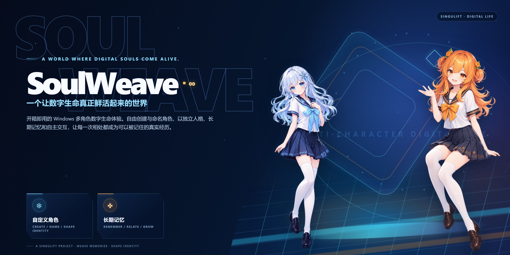
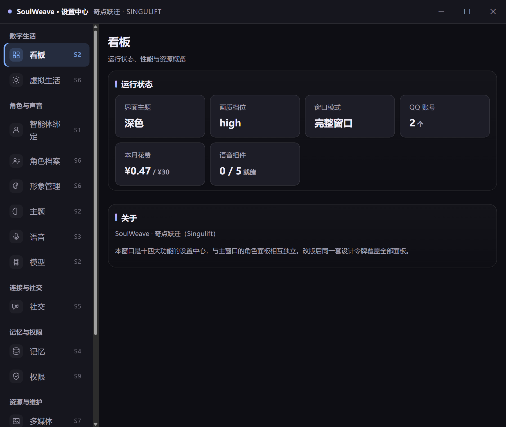
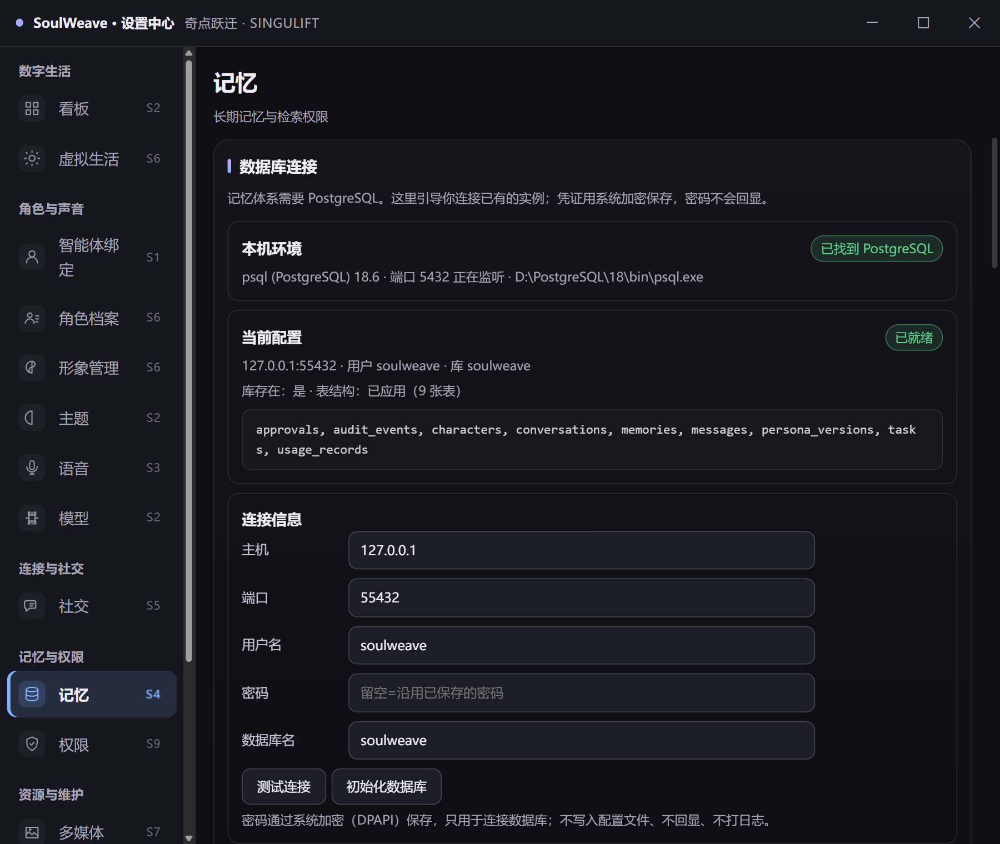
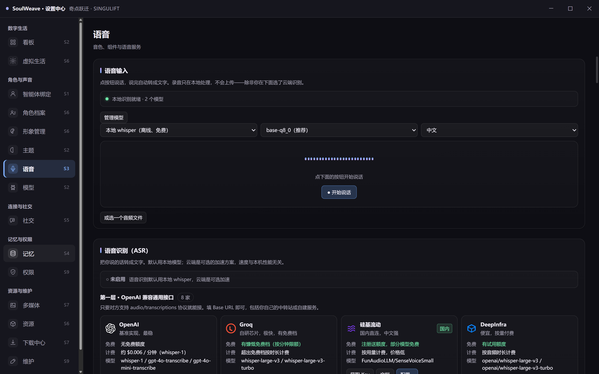
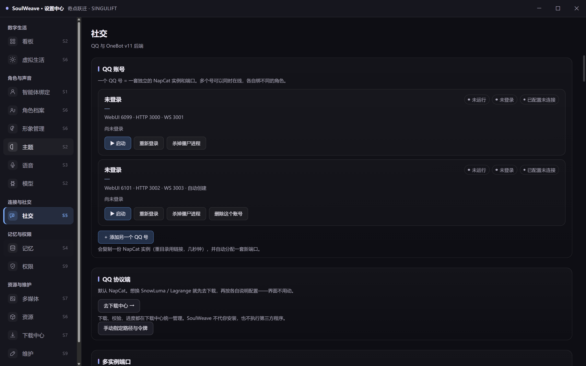

<p align="center">
  
</p>

<h1 align="center">SoulWeave</h1>

<p align="center"><strong>一个让数字生命真正鲜活起来的世界。</strong><br>
A World Where Digital Souls Come Alive.</p>

<p align="center">
  
  
  
  
  
</p>

<p align="center">
  <a href="https://soulweave.pages.dev"><b>官网与文档</b></a>
  ·
  <a href="https://github.com/zhouPi-314/soulweave/releases/download/v0.1.0-s1/SoulWeave-Setup-0.1.0-s1.exe"><b>下载 Windows 版</b></a>
  ·
  <a href="https://soulweave.pages.dev/releases.html"><b>版本与更新</b></a>
</p>

SoulWeave 是一款开箱即用的 Windows 多角色数字生命体验。你可以创建并命名角色，为每个角色配置独立人格、长期记忆、形象、语音与推理方式，让数字角色真正融入你的数字生活。

SoulWeave 不限定角色数量或固定身份。横幅中的角色形象仅用于展示视觉方向与产品氛围，不代表产品只包含两个角色。

> **当前版本状态：** `0.1.0-s1` 为 Windows 公开候选版本。安装前请核对 Release 中的 SHA-256 与系统要求。

## 可自定义的多角色数字生命

| 能力 | 说明 |
|---|---|
| **自定义身份** | 角色名称、人格、形象与表达方式由用户创建和调整，不绑定固定角色。 |
| **多角色共存** | 在一个产品中管理多个角色；每个角色拥有独立档案、记忆与运行配置。 |
| **本地或云端** | 角色可使用本地 DSH 或用户配置的云端模型服务，运行边界清楚可见。 |
| **角色隔离** | 记忆、权限、社交连接与配置按角色归属，避免不同角色互相污染。 |

## 从工具，到能够共同经历的数字生命

| 能力 | 说明 |
|---|---|
| **独立人格** | 角色拥有稳定身份、表达方式与行为倾向，不需要靠“换皮”区分。 |
| **长期记忆** | 重要对话、偏好与经历被整理和长期保存；记忆按角色隔离。 |
| **自主交互** | 在授权范围内主动交流，频率、场景和开关可配置。 |
| **Live2D 与语音** | 动态形象、表情、语音识别与语音合成共同构成更自然的存在感。 |
| **多角色互动** | 角色可以分别交流，也能在授权范围内共同参与。 |
| **桌面陪伴与 Life Studio** | 融入 Windows 日常环境，并探索生活、创作与动态表达。 |
| **QQ 社交** | 通过自备协议端接入私聊与群聊，支持白名单、触发规则与讨论额度。 |
| **权限与审计** | 敏感动作需要审批，授权可随时收回，关键操作留痕。 |

## Inside SoulWeave

以下均为项目真实现有界面，不使用概念图冒充已交付产品：

<p align="center">
  
  
</p>
<p align="center">
  
  
</p>

## 记忆与人格

长期记忆不只是保存更多文本，而是让偏好、经历与关系有机会参与后续交流，同时维持角色的人格连续性。

从一次对话，到一段能够被记住的共同经历。

> 官网中的记忆关系图是概念示意，不代表当前软件已经完整实现全部可视化能力。

## Local First

- **本地优先**：支持把角色与数据放在本地环境中运行。
- **云端边界清楚**：云端角色依赖模型服务，不是离线能力。
- **数据控制**：记忆、角色配置和聊天记录优先保存在用户设备。
- **模块化**：不同能力可以独立扩展与维护。
- **默认拒绝**：未经配置的高风险工具调用不会自动执行。

本地优先不等于所有场景完全离线。下载资源、QQ 接入、公告读取或用户主动触发的工具调用仍可能需要网络。

## 快速开始

```bash
git clone https://github.com/zhouPi-314/soulweave.git
cd soulweave
npm install
npm run build
npm test
npm run dev
```

环境：Windows 11 / Node.js 24 / 内置 PostgreSQL 18（随包，无需另装）。

## 技术栈

```text
Electron 45 · Node 24            桌面容器与主进程
TypeScript 5.9 · Vite 6          主进程 / 渲染层
Live2D Cubism SDK                角色渲染
PostgreSQL 18（嵌入式）          长期记忆与状态
DSH 引擎（本地） / 云端 API      角色推理
Whisper（本地） / TTS            语音识别与合成
OneBot v11（NapCat）             QQ 接入
```

## 文档与项目状态

- [官网](https://soulweave.pages.dev) · [安装与排障](https://soulweave.pages.dev/docs/index.html)
- [下载状态](https://soulweave.pages.dev/download.html) · [版本与校验](https://soulweave.pages.dev/releases.html)
- [关于项目](https://soulweave.pages.dev/about.html) · [隐私说明](https://soulweave.pages.dev/privacy.html)
- [架构决策](docs/adr/) · [第三方许可与 SBOM](docs/licensing/) · [发布说明](docs/RELEASE-0.1.0-s1.md)
- [第三方许可](NOTICE) · [依赖清单](THIRD-PARTY-LICENSES.md)

## 许可证

代码采用 [Apache License 2.0](LICENSE)。素材不自动继承代码许可，模型权重、Live2D 素材、音色与图标各自适用原始条款，见 [NOTICE](NOTICE)。

QQ 协议端（内置 NapCat）按其 *Limited Redistribution License* 分发：允许再分发，须附许可全文与署名，**仅限非商业用途**。

## 免责声明

第三方 QQ 协议端可能导致账号被限制或封禁，风险由使用者自行承担。AI 生成内容不代表本项目立场；角色的人格与记忆数据保存在本机。

<p align="center">A Singulift Project · 始于奇点，跃迁无限。</p>
